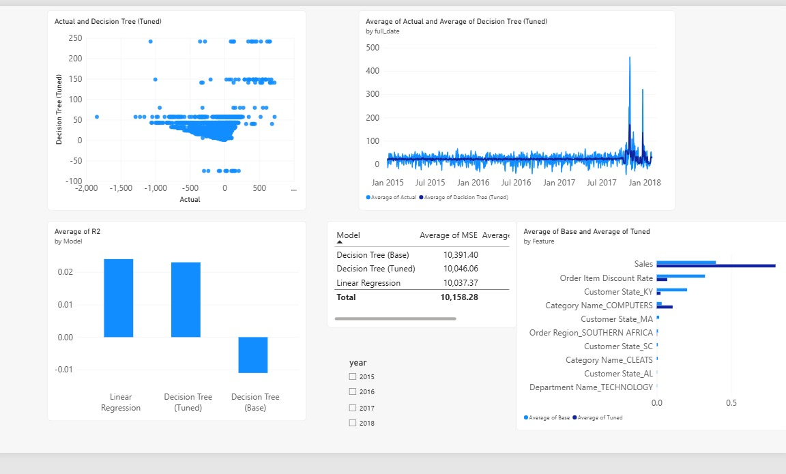

# Benefit per Order (Regression)

Evaluates whether pre-fulfillment order attributes can predict order profitability (`-$4,274.98` to `$911.80`, mean = `$21.97`) after removing post-facto accounting leakage (`Order Item Profit Ratio`, `Order Item Total`).

## Contents

- `benefit_per_order_clean.py`: Leakage-free regression pipeline.
- `bpo_predictions.csv`: Test-set predictions (`36,104` rows, joined to Power BI via `Order Item Id`).
- `bpo_comparison.csv`: Model comparison table across Linear Regression, Decision Tree (Base), and Decision Tree (Tuned).
- `bpo_importance.csv`: Base vs. Tuned Decision Tree feature importances.
- `plots/`: 8 Matplotlib figures (Actual vs. Predicted scatter plots, Base & Tuned Decision Tree diagrams, Feature Importance charts, and R² Comparison).
- `PowerBI_Modeling_BPO.jpg`: Power BI modeling page snapshot.

## Key Results (36,104 Test Orders)

| Model | R² | MSE | MAE ($) |
|---|---:|---:|---:|
| Linear Regression | 0.024 | 10,037.371 | 54.068 |
| Decision Tree (Base) | -0.011 | 10,391.404 | 55.094 |
| Decision Tree (Tuned) | 0.023 | 10,046.056 | 54.058 |

- **Pruning Impact:** Tuning eliminated overfitting (`R²` improved from `-0.011` to `0.023`), shifting importance from noisy state indicators to `Sales` (**79.65%**), `Category Name_COMPUTERS` (**10.67%**), and `Order Item Discount Rate` (**7.06%**).
- **Finding:** Low `R²` (`0.024`) confirms that without unit-cost/COGS data, pre-order attributes alone cannot accurately predict net order profit.

## Model Plots

