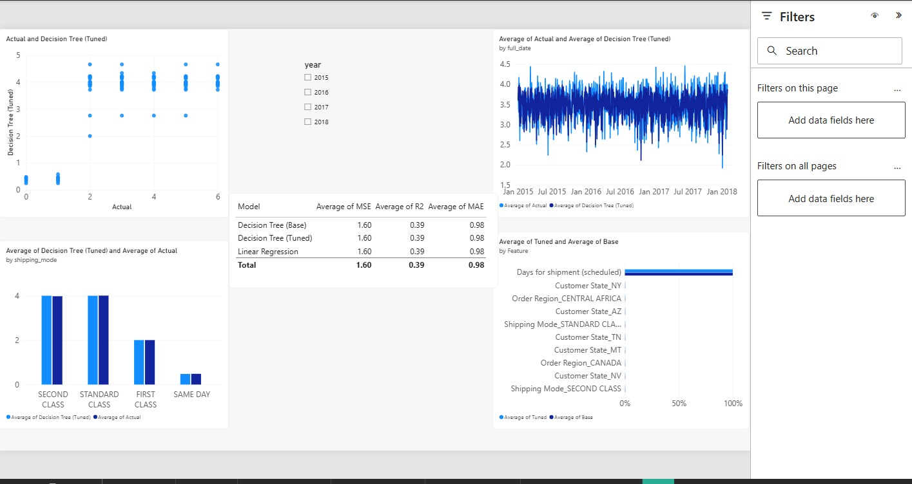

# Days for Shipping Real (Regression)

Predicts actual shipping duration in days (`0` to `6` days, mean = `3.498`) to improve delivery-time estimates and SLA planning.

## Contents

- `days_for_shipping_real_clean.py`: Leakage-free regression pipeline.
- `dfs_predictions.csv`: Test-set predictions (`36,104` rows, joined to Power BI via `Order Item Id`).
- `dfs_comparison.csv`: Model comparison table across Linear Regression, Decision Tree (Base), and Decision Tree (Tuned).
- `dfs_importance.csv`: Base vs. Tuned Decision Tree feature importances.
- `plots/`: 8 Matplotlib figures (Actual vs. Predicted scatter plots, Base & Tuned Decision Tree diagrams, Feature Importance charts, and R² Comparison).
- `PowerBI_Modeling_DFS.jpg`: Power BI modeling page snapshot.

## Key Results (36,104 Test Orders)

| Model | R² | MSE | MAE (Days) |
|---|---:|---:|---:|
| Linear Regression | 0.392 | 1.602 | 0.983 |
| Decision Tree (Base) | 0.392 | 1.602 | 0.981 |
| Decision Tree (Tuned) | 0.392 | 1.602 | 0.981 |

- **Top Feature:** `Days for shipment (scheduled)` accounts for **99.84%** of importance in both Base and Tuned trees.
- **Mean Alignment:** Tuned predicted mean (`3.498` days) matches the actual test mean (`3.498` days) with zero systematic bias.
