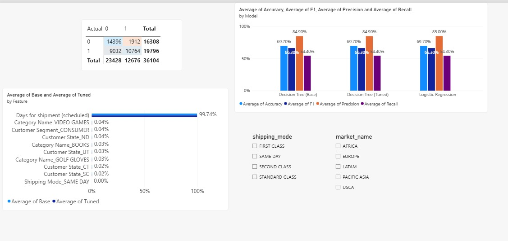

# Late Delivery Risk (Binary Classification)

Predicts whether an order will be delivered late (`0 = On Time`, `1 = Late`) prior to dispatch to support proactive flagging of high-risk orders.

## Contents

- `late_delivery_risk_clean.py`: Leakage-free classification pipeline.
- `ldr_predictions.csv`: Test-set predictions (`36,104` rows, joined to Power BI via `Order Item Id`).
- `ldr_comparison.csv`: Model comparison table across Logistic Regression, Decision Tree (Base), and Decision Tree (Tuned).
- `ldr_importance.csv`: Base vs. Tuned Decision Tree feature importances.
- `plots/`: 8 Matplotlib figures (Confusion Matrices, Base & Tuned Decision Tree diagrams, Feature Importance charts, and Model Comparison).
- `PowerBI_Modeling_LDR.jpg`: Power BI modeling page snapshot.

## Key Results (36,104 Test Orders)

| Model | Accuracy | Precision | Recall | F1 Score |
|---|---:|---:|---:|---:|
| Logistic Regression | 0.697 (69.7%) | 0.850 (85.0%) | 0.543 (54.3%) | 0.663 (66.3%) |
| Decision Tree (Base) | 0.697 (69.7%) | 0.849 (84.9%) | 0.544 (54.4%) | 0.663 (66.3%) |
| Decision Tree (Tuned) | 0.697 (69.7%) | 0.849 (84.9%) | 0.544 (54.4%) | 0.663 (66.3%) |

- **Confusion Matrix (Tuned):** `14,396` True Negatives, `1,912` False Positives, `9,032` False Negatives, `10,764` True Positives.
- **Top Feature:** `Days for shipment (scheduled)` accounts for **99.79%** of splitting importance after tuning.

## Model Plots

